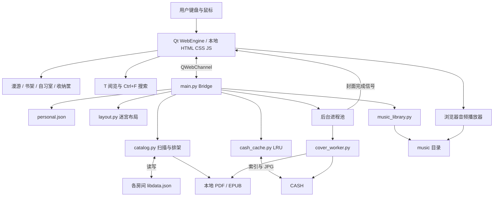

# 无限图书回廊

基于 **Python + PyQt6 + Qt WebEngine** 的 Windows 本地图书馆。把真实文件夹变成可漫游的房间，用书架和自习室整理 PDF、EPUB。界面由本地 HTML、CSS、JavaScript 绘制，不依赖在线服务。

## 下载与运行

封版文件：`dist/VirtualLibrary-Final/VirtualLibrary.exe`。

1. 将 **一个 EXE** 放进具有写入权限的文件夹，例如 `D:\InfiniteLibrary`。
2. 双击启动。无需另装 Python、Qt，也无需复制 `web` 或 `_internal`。
3. 点击“管理入口 / 路径”，添加书籍文件夹；可选普通书室或家具桌面。
4. 保存后进入大厅，沿迷宫走到入口，按回车或点击入口进入。

单文件版启动时会自动把运行依赖解压到系统临时目录，因此首次启动比目录版慢。启动后生成的配置、封面缓存和音乐位于 EXE 旁边，书室布局位于各书籍文件夹内；“单 EXE 分发”不代表运行后不产生数据文件。

请勿放在只读目录或无写入权限的系统目录。应用没有随包附带个人书籍、个人入口路径或音乐。

## 功能

- 稳定迷宫布局、方向键漫游、平滑跟随、碰墙回弹；不存在的入口显示维护状态。
- 按真实目录层级归并入口，同一路径不重复、子目录不重复出现在大厅；家具类型可保留到原层级。
- PDF、EPUB 书架；按页数确定厚度，紧密排列，每架六层，超宽自动进入下一层或下一架。
- 书架预览每组最多八架，使用书名生成的纯色，不批量生成封面。
- 进入具体书架时显示封面加载进度；封面缓存使用 LRU，超过 3000 张清理到 1500 张。
- 拖动书籍调整顺序，布局保存到所在房间；空间不足时拒绝插入。
- 左侧收纳筐，可收起，按一层书架的厚度容量收纳；书籍独立缩放，不跟随主视角。
- 自习室桌面堆叠、拖动位置保存，TXT 文件展示前 60 个字符。
- T 阅览模式：独立半透明封面虚影，约原模式 2.5 倍，按需加载高清首页，不改变书架布局。
- Ctrl+F 搜索当前书架完整书名，匹配结果蓝光描边。
- 查看信息、系统关联阅读器打开、文件定位、改名；显示名称截断不修改实际文件名。
- 音乐导入、选曲、音量、自动播放、暂停、重放与删除；播放时唱盘旋转。

## 基本操作

| 操作 | 方法 |
| --- | --- |
| 漫游移动 | 方向键或 WASD |
| 进入当前入口 | 回车；也可到达入口后点击 |
| 返回上一级 | Esc 或页面返回按钮；搜索打开时 Esc 优先关闭搜索 |
| 缩放 / 平移 | 鼠标滚轮 / 鼠标中键拖动 |
| 恢复全景 | 适应画面 |
| 查看书籍信息 | 点击书籍，右侧详情出现 |
| 开启 / 关闭阅览虚影 | 进入具体书架后按 T，悬停书脊 |
| 搜索书名 | 进入具体书架后 Ctrl+F，实时输入；Esc 清除并关闭 |
| 加入收纳筐 | 将书脊、详情封面或自习室的书拖入左侧筐 |
| 移动到另一房间 | 收纳后进入目标房间，点击“放下到当前房间” |
| 调整书架顺序 | 拖到目标层的插入位置；空间不足时保持原位 |
| 打开书籍 | 双击封面，或点击“选中文件并打开书籍” |
| 只定位文件 | 详情中“打开所在文件夹” |
| 音乐设置 | 左上角音乐按钮 |

**放下是移动磁盘文件，不是复制快捷方式。** 同名目标不会被覆盖；移动失败时书保留在筐内。清空或移除筐内书籍不会删除原书。收纳筐内容仅在本次运行期间保留。

## 首次配置与日常使用

- 在设置中添加文件夹路径。目录内的子目录自动成为入口；同时包含书和子目录时出现“本层书架”。
- 选择“家具桌面”可以把指定目录用作自习室，拖动后的位置自动保存。
- 目录发生外部变化后点击刷新。第一次扫描新书需要读取页数，数量很多或位于网络盘时可能较慢。
- EPUB 没有固定分页，厚度使用阅读引擎默认排版页数并标注“估算”。首页不一定是出版社封面。DOCX 暂未支持。
- 损坏、加密或无法解析的文件仍可能显示入口，但无封面时仅显示纯色。原始低清扫描不能通过高清预览恢复细节。
- 音乐导入要求可识别时长且至少 30 秒；复制一份到 `music`。删除只删除该目录中的副本。支持程度取决于 Qt 音频解码能力。
- 书名含控制符、替换字符等明显异常内容时显示前 10 字符加省略号，正常书名超过 50 字符时截断；不是通用乱码修复。

## 数据存放与升级

| 路径 | 用途 / 生成时机 |
| --- | --- |
| `personal.json` | 首次启动自动创建；入口、房间布局种子、上次房间、音乐偏好 |
| `CASH/`、`CASH/index.json` | 首次启动自动创建；缩略图和高清预览的磁盘 LRU 索引 |
| `music/` | 首次启动自动创建；用户导入的音频副本 |
| 每个书室的 `libdata.json` | 首次扫描书室时生成；文件标识、页数、顺序、桌面坐标与指纹 |
| `%LOCALAPPDATA%/VirtualLibrary/` | 兼容旧版本数据位置；旧 SQLite 仅用于导入历史位置 |
| 系统临时目录 `_MEI…` | PyInstaller 单文件运行时自动解压的依赖，不是持久数据目录 |

旧书室只有 `lib.json` 时，会读取并在同步时写出 `libdata.json`，保留旧文件作为备份；两者同时存在时以 `libdata.json` 为准。新文件损坏时会报错，不静默覆盖。

升级时先关闭软件。可以用新版 EXE 替换旧 EXE并保留其旁边的 `personal.json`、`music`、`CASH`；从旧目录版迁移到新目录时一并复制这些数据，检查相对路径是否仍指向正确位置。书室的布局文件随书室保留。备份书库时应同时备份 `libdata.json`。

## 源码运行与构建

在 Windows PowerShell 中运行（开发验证环境：Python 3.14、Windows 10）：

```powershell
python -m venv .venv
.\.venv\Scripts\Activate.ps1
python -m pip install -r requirements.txt
python main.py
python -m unittest -v
.\build.ps1
```

`build.ps1` 使用 PyInstaller `--onefile`，嵌入 `web/` 和 Qt 依赖，再由 `publish.ps1` 发布 EXE 与说明文档，不把开发者配置打入发布包。

界面冒烟检查：`VirtualLibrary.exe --smoke-test`。此模式会短暂运行界面、写出 `smoke-result.txt` 与截图后退出；无配置的干净目录只检查大厅，完整书架检查需要可进入的示例书室。正常用户双击无需此参数。

## 文件与文件夹说明

| 文件 / 目录 | 职责 |
| --- | --- |
| `main.py` | Qt 窗口、QWebChannel 桥接、房间导航、配置、文件操作与封面任务调度 |
| `catalog.py` | 书籍扫描、路径编码、页数缓存、排架、布局迁移、改名与移动 |
| `layout.py` | 由稳定种子生成并保存迷宫、入口位置 |
| `cover_worker.py` | 后台进程渲染 PDF / EPUB 首页为 JPG |
| `cash_cache.py` | 封面缓存索引、指纹、访问顺序及淘汰 |
| `music_library.py` | 音频导入时长检查、复制、删除、列表与设置 |
| `web/index.html` | 页面骨架与脚本入口 |
| `web/style.css` | 布局、书脊材质、弹层、搜索与动画样式 |
| `web/app.js` | 主界面状态、书架、漫游、桌面拖放、收纳筐和封面加载 |
| `web/view.js` | 缩放、平移与视角保存 |
| `web/reading.js` | T 阅览模式、单个虚影、高清懒加载与小型内存缓存 |
| `web/search.js` | 当前书架的书名搜索与高亮 |
| `web/settings.js`、`web/rename.js` | 入口设置与改名对话框 |
| `web/music.js` | 音乐面板、播放控制、唱盘状态 |
| `web/wood.js`、`web/marble.js` | 程序生成木纹与大理石纹理 |
| `web/smoke.js` | 界面自动检查脚本 |
| `test_*.py` | 目录布局、缓存、导航、文件操作、EPUB 和迁移测试 |
| `verify_ui.py` | 开发期辅助界面检查工具，不是启动入口 |
| `requirements.txt` | Python 依赖版本 |
| `build.ps1`、`publish.ps1` | 单文件构建及发布 |
| `DEVELOPMENT_LOG.md` | 开发历史与版本变更 |
| `demo/`、`test-data/` | 开发演示 / 测试素材，不作为用户配置发布 |
| `build/`、`dist/`、`*.spec` | 构建中间产物、发布产物和 PyInstaller 生成配置 |

## 程序架构

GitHub 可直接渲染下列 Mermaid 图：




